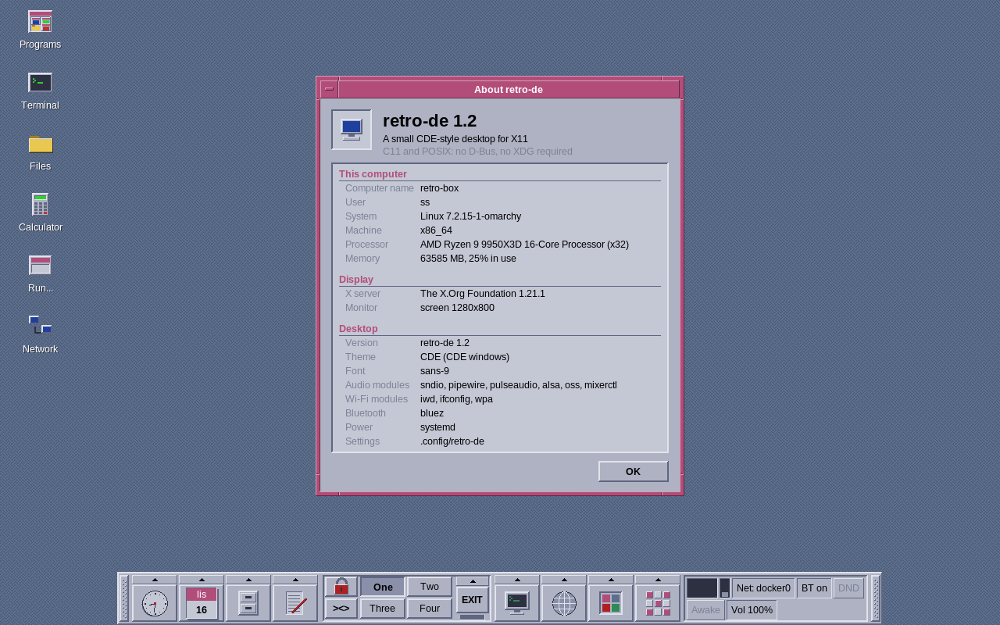
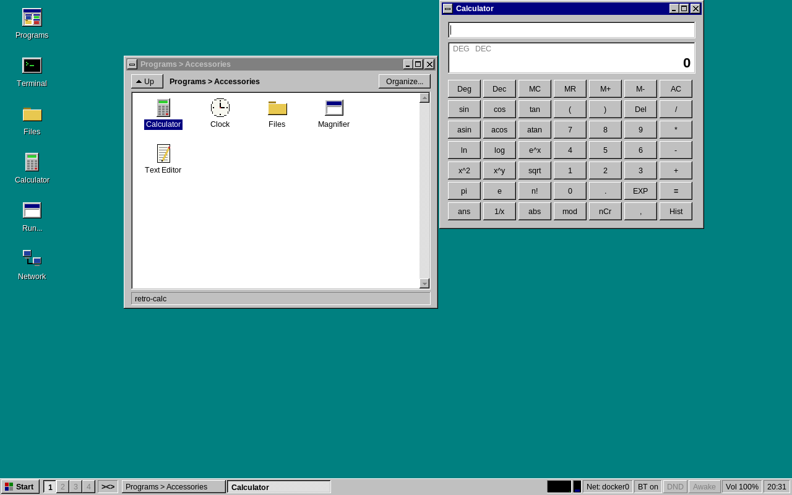
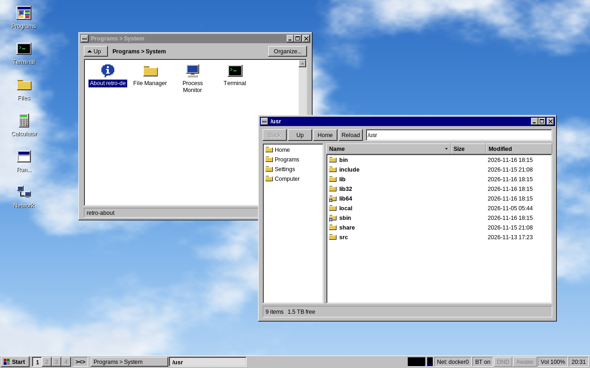
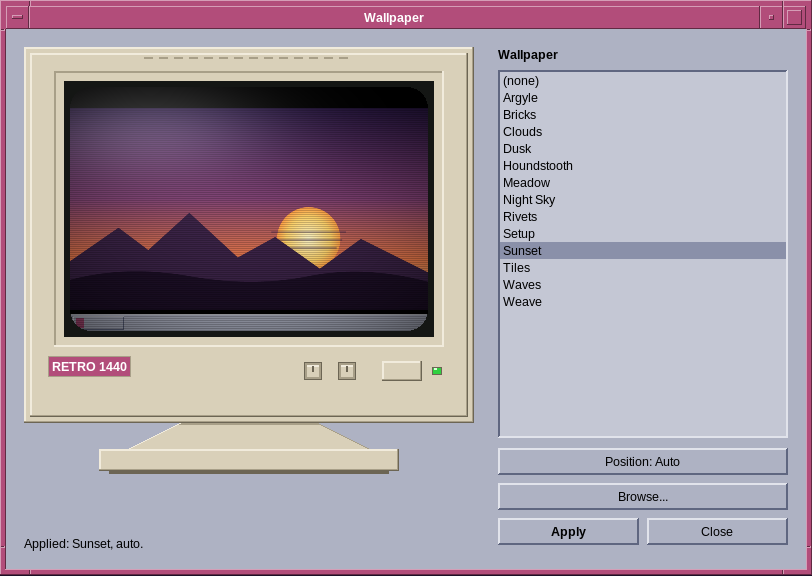

<div align="center">

# retro-de

**A small CDE / Windows-95 style desktop environment for X11, written in plain C.**

*Bevels, front panels, Start menus and program groups, without D-Bus, XDG or anything else you didn't ask for.*




</div>

<table>
<tr>
<td width="50%"></td>
<td width="50%"></td>
</tr>
<tr>
<td align="center"><sub><b>Classic</b>: taskbar, Programs window, scientific calculator</sub></td>
<td align="center"><sub><b>Redmond</b> theme module: wallpaper, program group, file explorer</sub></td>
</tr>
</table>

---

## Why

Most desktops pull in a session bus, a settings daemon, an icon theme
engine and a menu specification before the first window appears.
**retro-de** needs only **libc, Xlib, Xft, Xinerama, Xrandr and Xext**.
Everything else (D-Bus, XDG menus and autostart, audio servers, network
daemons) is used **when present and ignored when not**. The same build runs
under systemd, elogind, OpenRC, runit, s6, sysvinit, dinit or a BSD `rc`.

It is about 28 000 lines of C11 that build without warnings under
`-std=c11 -Wall -Wextra -pedantic` with gcc and clang, with GNU or BSD make.

## Highlights

|   |   |
|---|---|
| 🪟 **Two looks** | CDE/Motif frames with desktop icons for minimized windows, or Windows-95-style Classic frames, switched live |
| 🧭 **Two panels** | A Win95 taskbar (Start menu, pager, tasks, tray, applets) or the CDE front panel with subpanels and named workspaces |
| 📁 **Programs folder** | Your Programs menu *is* a folder: categories are sub-folders, programs are files. Arrange it with any file manager |
| 🗂️ **Program Manager** | The **Programs** icon on the desktop opens that folder as a window of icons, each with its own picture |
| ℹ️ **About box** | Version, system, processor, memory, monitors and the modules in use, also as text (`retro-about -t`) |
| 🎨 **Themes as C** | Nine built-in palettes, plain `.theme` files, or compiled theme modules that draw their own bevels and bring wallpapers |
| 🖥️ **Monitors** | Per-monitor resolution and refresh rate, arrangement by drag, profiles, restored at login (RandR, no `xrandr` needed) |
| 🧲 **Window snapping** | Halves and quarters by key or edge-drag, sticky edges, float/tile/monocle layouts, Alt+Tab |
| 🔌 **dwm-like modules** | Pick audio, Wi-Fi, Bluetooth, battery and power back ends with `./configure`; only those are compiled in |
| 🧰 **Own tools** | Style Manager, file explorer, scientific calculator, run dialog, Wi-Fi and Bluetooth dialogs |
| 📡 **Own bus** | `retro-bus` and `retro-msg` let programs and shell scripts call the desktop and each other, without D-Bus |
| 🔔 **Notifications** | Popups with icons, action buttons and urgency, a "do not disturb" switch and a history applet |
| 🚌 **D-Bus stand-in** | Optional `retro-dbus`: programs that need a session bus work without `dbus`; notifications and the file chooser portal go to retro-de |
| 🖼️ **PNG and SVG** | Icons and wallpapers in PNG, SVG, XPM or PPM, decoded in-house (no libpng, zlib or librsvg) |
| 📦 **Theme packages** | `.rtp` packages bring palettes, wallpapers and icon themes; `retro-pkg install --apply` |
| 📺 **Wallpaper on a CRT** | `retro-wallpaper` previews your wallpaper on an old monitor, with scan lines, and degausses when applied |

## Quick start

```sh
git clone https://github.com/DobryZiomek/retro-de.git && cd retro-de
./configure --defaults      # detect audio, Wi-Fi, power... and write config.h
make                        # programs, theme modules and wallpapers
make check                  # optional: unit tests + two full sessions in Xvfb
sudo make install           # PREFIX=/usr/local, DESTDIR supported
```

Then put `exec retro-session` in `~/.xinitrc`, or pick **Retro** in your
display manager. Try it inside your current desktop without installing:

```sh
Xephyr :2 -screen 1280x800 &
DISPLAY=:2 PATH="$PWD/bin:$PATH" RETRO_DE_DATA_DIR="$PWD" retro-session
```

## Contents

- [Install](#install) · [Starting it](#starting-it) · [Modules](#modules) · [Bus, notifications, icons](#the-bus-notifications-and-icons-without-d-bus-or-xdg) · [retro-dbus](#d-bus-without-d-bus-retro-dbus-optional-package) · [Theme packages](#theme-packages-retro-pkg) · [Wallpaper](#wallpaper) · [Optional integrations](#optional-integrations)
- [Default applications](#default-applications) · [The taskbar](#the-taskbar) · [The programs folder](#the-programs-folder) · [The Programs window](#the-programs-window) · [About](#about)
- [Monitors](#monitors) · [Moving windows](#moving-windows) · [Do not disturb, screen saver](#do-not-disturb-keeping-the-screen-on-the-screen-saver)
- [Configuration by hand](#configuration-by-hand) · [File explorer and calculator](#file-explorer-and-calculator) · [Bluetooth](#bluetooth)
- [CDE front panel](#the-cde-front-panel-and-windows) · [Style Manager](#style-manager) · [Keys and mouse](#keys-and-mouse) · [Configuration files](#configuration-files)
- [OS notes](#os-notes) · [Testing](#testing) · [Contributing](#contributing) · [License](#license) · [Contact](#contact) · [Limits](#limits)

## The programs

| Program | Role |
|---------|------|
| `retro-session` | Starts and supervises the desktop; `exec` it from `~/.xinitrc` or pick "Retro" in a display manager |
| `retro-wm` | Re-parenting window manager: Motif or Classic frames, EWMH/ICCCM, workspaces, float/tile/monocle layouts, Alt+Tab |
| `retro-bar` | Windows-95 taskbar or CDE front panel: menus, pager, XEMBED tray, applets (CPU, RAM, battery, network, Bluetooth, volume, clock, custom blocks) |
| `retro-desk` | Backdrop (colour, pattern, XPM/PPM wallpaper per monitor), desktop icons, workspace menu |
| `retro-programs` | The programs folder as a window of icons (`-l` lists it) |
| `retro-bus` | The desktop's own message bus (instead of D-Bus); started by `retro-session` |
| `retro-msg` | Talk to the bus from the shell: calls, events, notifications, script services |
| `retro-wallpaper` | Wallpaper chooser with a CRT-monitor preview |
| `retro-pkg` | Installs, applies and makes theme packages (`.rtp`) |
| `retro-dbus` | *Optional package:* a D-Bus session bus stand-in with notifications and portals |
| `retro-about` | About retro-de and this computer (`-t` prints it) |
| `retro-settings` | Style Manager; installs theme modules |
| `retro-display` | Monitors: on/off, arrangement, resolution, refresh rate, rotation, primary |
| `retro-bt` | Bluetooth devices (`-t` for a terminal mode) |
| `retro-files` | File explorer: places, sortable list, copy/move/delete/rename |
| `retro-calc` | Scientific calculator (`-e EXPR` prints a result) |
| `retro-run` | Run dialog with history and `$PATH` completion |
| `retro-net` | Wi-Fi switcher (`-t` for a terminal mode) |
| `libretroui.a` | The shared toolkit: Motif/Classic bevels, widgets, menus, dialogs, pictograms, Xft or core fonts, double buffering |

## Install

### Packages

Every [release](https://github.com/DobryZiomek/retro-de/releases) has
ready packages, built with the default `config.h` (all modules, chosen at run
time):

| System | File | Install |
|---|---|---|
| Debian 11+, Ubuntu 20.04+ | `retro-de_VERSION-1_amd64.deb` | `sudo apt install ./retro-de_*.deb` |
| Fedora, RHEL/Alma/Rocky 8+, openSUSE | `retro-de-VERSION-1.x86_64.rpm` | `sudo dnf install ./retro-de-*.rpm` (openSUSE: `sudo zypper install --allow-unsigned-rpm ./retro-de-*.rpm`) |
| Arch Linux and derivatives | `retro-de-VERSION-1-x86_64.pkg.tar.zst` | `sudo pacman -U retro-de-VERSION-*.pkg.tar.zst` |
| Alpine 3.20+ | `retro-de-VERSION-r0-x86_64.apk` | `sudo apk add --allow-untrusted retro-de-*.apk` |
| OpenBSD 8.0 | `retro-de-VERSION-openbsd-8.0-amd64.tgz` | rename to `retro-de-VERSION.tgz`, then `doas pkg_add -D unsigned ./retro-de-VERSION.tgz` |

Each system also gets the optional **`retro-de-dbus`** package
(`retro-de-dbus_VERSION-1_amd64.deb`, `retro-de-dbus-VERSION-...`). It
holds [retro-dbus](#d-bus-without-d-bus-retro-dbus-optional-package), for
programs that need a D-Bus session bus when `dbus` is not installed.
Install it next to `retro-de`, or leave it out.

`SHA256SUMS` lists the checksums. The recipes are in `packaging/`
(`retro-de.spec`, `PKGBUILD`, `APKBUILD`, `deb.sh`, `openbsd.sh`);
`sh packaging/build.sh` builds the Linux packages in docker, and a pushed
`v*` tag builds them on GitHub Actions.

### From source

    ./configure      # menus: audio, Wi-Fi, Bluetooth, battery, power/init,
                     # D-Bus, XDG, theme, style, font, default tools, prefix
    make
    make install     # PREFIX/DESTDIR; also installs the xsession file
    make install-dbus  # optional: retro-dbus, the D-Bus stand-in

`./configure` shows `dialog`/`whiptail` menus when one is installed and plain
numbered menus otherwise. It detects what the system has and pre-selects it,
writes `config.h` (and the prefix into `config.mk`), and can run the build
and install for you. Non-interactive use:

    ./configure --defaults                       # detect everything
    ./configure --defaults --audio=pulseaudio --wifi=iwd --power=elogind,generic \
                --dbus=off --xdg-autostart=no --theme=Broica --browser=firefox

`./configure --help` lists every option. You can also skip it and edit
`config.h` by hand like dwm (the first `make` copies `config.def.h`).

Building needs the X11, Xft, Xinerama, Xrandr and Xext headers, `pkg-config` (with
fallbacks for `/usr/X11R6`, `/usr/X11R7`, `/usr/local`, `/usr/pkg`), and
either GNU or BSD make. It builds without warnings under
`-std=c11 -Wall -Wextra -pedantic` with gcc and clang. `make` also builds the
theme modules in `themes/` and paints the wallpapers (`tools/mkwall`, at
`WALL_W` x `WALL_H` from `config.mk`). Theme modules are loaded with
`dlopen(3)`, so the programs are linked with `-rdynamic` (and `-ldl` where
libc lacks it); both are set in `config.mk`.

## Starting it

- **startx / xinit / xenodm**: `exec retro-session` in `~/.xinitrc` (see
  `examples/xinitrc`).
- **Display managers** (LightDM, SDDM, GDM, slim, ...): `make install` puts
  `retro.desktop` in `$(PREFIX)/share/xsessions` (set `XSESSIONSDIR` in
  `config.mk`, empty to skip).

`retro-session` restores the saved monitor layout, starts the window
manager, desktop and panel, creates the programs folder on first login, runs
`~/.config/retro-de/autostart` (a shell script), optionally the XDG
autostart entries, and restarts a crashed component up to five times. It
does not depend on the init system: it is fork, exec and waitpid.

## Modules

Each module is one small file in `modules/` that drives a command-line tool
or reads a kernel interface; none links a library. `config.h` lists the
modules to build, in the order they are probed at run time:

| Kind | Module | Uses | For |
|------|--------|------|-----|
| audio | `sndio` | `sndioctl` | OpenBSD, sndio anywhere |
| audio | `pipewire` | `wpctl` | PipeWire |
| audio | `pulseaudio` | `pactl` | PulseAudio, pipewire-pulse |
| audio | `alsa` | `amixer` | ALSA |
| audio | `oss` | `mixer` | FreeBSD |
| audio | `mixerctl` | `mixerctl` | NetBSD |
| Wi-Fi | `iwd` | `iwctl` | Linux iwd |
| Wi-Fi | `ifconfig` | `ifconfig` | OpenBSD |
| Wi-Fi | `wpa` | `wpa_cli` | wpa_supplicant |
| Bluetooth | `bluez` | `bluetoothctl` | Linux BlueZ |
| battery | `sysfs` / `acpi` / `apm` | sysfs, sysctl, apm | Linux / FreeBSD / OpenBSD, NetBSD |
| power | `systemd` | `systemctl` | systemd as PID 1 |
| power | `elogind` | `loginctl` | elogind (OpenRC, runit, s6...) |
| power | `consolekit` | `dbus-send` | ConsoleKit2 |
| power | `openbsd` / `freebsd` / `netbsd` | `shutdown`, `zzz`, `acpiconf`, `sysctl` | the BSDs |
| power | `generic` | `poweroff`, `reboot`, `zzz` | sysvinit, runit, s6, OpenRC, dinit |

Power modules check what is actually running (for example "is systemd PID
1?"), so one build serves several systems. The plain-init and BSD modules
run their commands through `power_priv` (`doas -n` or `sudo -n` by default;
allow them without a password in `doas.conf`/`sudoers`). A new module is a
`RuiAudioModule`, `RuiNetModule`, `RuiBtModule`, `RuiBatteryModule` or
`RuiPowerModule` in
a new file (`modules/audio_alsa.c` is a complete example in under 50 lines),
added to `MODOBJS` in the Makefile and to the list in `config.h`.

## The bus, notifications and icons without D-Bus or XDG

**retro-bus.** Programs still need to talk to each other and to the
desktop, so retro-de has its own message bus: one small process on a Unix
socket, started by `retro-session` (`bus = off` in `retro.conf` turns it
off). Its address is exported as `RETRO_BUS`; without it programs find it at
`${TMPDIR:-/tmp}/retro-de-UID/bus-DISPLAY`. The protocol is one line of text
per message, so a shell script is a full peer. Programs claim **service
names**, **call** methods on each other and **emit** events that others
**listen** to. See [docs/BUS.md](docs/BUS.md).

```sh
retro-msg list                                  # wm, notify, launcher ...
retro-msg notify "Backup" "Finished in 3 minutes"
retro-msg notify -u critical -A 'retry:Retry|log:Show log' "Build failed" "see make.log"
retro-msg call launcher open https://example.org   # the default browser
retro-msg call launcher run @terminal
retro-msg call wm windows                       # id, workspace, class, title
retro-msg call wm workspace 2                   # any keys.conf action
retro-msg listen 'wm.*' 'notify.*'              # print events as they come
retro-msg serve weather ./weather.sh            # a service written in sh
```

| Service | Provided by | Methods |
|---|---|---|
| `bus` | retro-bus | `ping`, `version`, `list`, `name`, `release`, `listen`, `unlisten` |
| `wm` | retro-wm | every `keys.conf` action (`close`, `maximize`, `workspace N`, `snap left`, `dnd on` ...), `windows`, `focus ID`, `close_window ID`, `actions` |
| `notify` | retro-bar | `show SUMMARY [BODY [SECONDS [ICON [URGENCY [ACTIONS [APP [REPLACES]]]]]]]` → its number, `close ID`, `history`, `clear`, `count`, `center` |
| `launcher` | retro-bar | `run COMMAND` (`@terminal`, `@browser` ... too), `open FILE-OR-URL` |

Events: `wm.focus`, `wm.workspace`, `wm.dnd`, `notify.clicked`,
`notify.action`, `notify.closed`, `bus.join`, `bus.leave`.

**Notifications.** retro-bar is the notification system. Popups stack
beside the panel's clock with the program's name, an icon (a pictogram, a
PNG/SVG/XPM file or an icon name) and up to four action buttons. **Low**,
**normal** and **critical** urgency are shown differently, and critical
ones stay until clicked. A notification can update another in place. While
**do not disturb** is on, popups are held back (critical ones still show)
but kept. The **`notes`** applet ("Msg 3") counts what you have not seen
and opens the list of the last 50 notifications, with **Clear all**.
`notifications = off` leaves the job to another daemon, and
`notification_time` sets how many seconds a popup stays.

**Icons.** Pictures may be **PNG, SVG, XPM or PPM**. retro-de decodes them
itself, without libpng, zlib or librsvg. The SVG renderer handles paths,
shapes, transforms, gradients, strokes and CSS classes, which is enough
for application icon themes. A program's own icon comes from its window
(`_NET_WM_ICON`, which every toolkit sets). The taskbar shows it on the
task button, and `retro-bar` keeps a copy as
`~/.config/retro-de/icons/learned/CLASS.xpm`. From then on the Programs
window, the desktop and `Icon=NAME` in `.desktop` files find that picture
by the program's name. An icon NAME is looked up, first match wins, in:

1. `~/.config/retro-de/icons/NAME.png|svg|xpm|ppm`
2. the installed `icons/` folder
3. the learned icons
4. the `icon_theme` you set (for example `icon_theme = Papirus`, searched
   in `~/.config/retro-de/icons/THEME`, `~/.local/share/icons/THEME` and
   `/usr/share/icons/THEME`)
5. `hicolor` and `pixmaps`

There is no index.theme parsing: the usual size and category folders are
simply tried.

## D-Bus without D-Bus: retro-dbus (optional package)

Many programs refuse to start, or lose features, without a session bus:
GTK and Qt applications, Electron, Firefox, `notify-send`. The optional
**`retro-de-dbus`** package (`make install-dbus` from source) adds
**`retro-dbus`**, a session bus written from scratch. It speaks the real
D-Bus wire protocol, so these programs connect to it as they would to
dbus-daemon, and no `dbus` package is needed. It has:

- EXTERNAL authentication.
- Unique and well-known names, with queues and replacement.
- Match rules (sender, interface, member, path, path_namespace,
  destination, argN, argNpath, arg0namespace), so signals reach those who
  listen.
- All `org.freedesktop.DBus` methods and signals that programs use, plus
  `BecomeMonitor`, so `dbus-monitor` works.
- **Activation** from the `.service` files in `dbus-1/services`, so dconf,
  gvfs and the like start on demand.

It is tested with libdbus (`dbus-send`, `dbus-monitor`), GDBus (`gdbus`,
`notify-send`), sd-bus (`busctl`) and python-dbus. Passing file
descriptors is not supported, and clients are told so when they connect.

The desktop answers on it itself:

| Name | Interface | Goes to |
|---|---|---|
| `org.freedesktop.Notifications` | `Notify` (app name, icon, actions, urgency, timeout, replaces), `CloseNotification`, `GetCapabilities`; the `ActionInvoked` and `NotificationClosed` signals come back | retro-bar's notifications |
| `org.freedesktop.portal.Desktop` | `FileChooser.OpenFile`, `SaveFile`, `SaveFiles` | a **retro-files** chooser window (`retro-files --choose`) |
| | `OpenURI.OpenURI` | the default browser, file manager or editor |
| | `Settings.Read`, `ReadOne`, `ReadAll` (color-scheme) | |

With `dbus = auto` (the default) `retro-session` starts retro-dbus when it
is installed, falling back to dbus-daemon when it is not. It also sets
`GTK_USE_PORTAL=1`, so GTK programs use the retro-de file chooser. Settings
in `retro.conf`:

- `dbus_server = auto | retro | dbus-daemon`
- `dbus_notifications = off` leaves `org.freedesktop.Notifications` to
  another daemon.
- `dbus_portal = off` leaves the portal names to xdg-desktop-portal.

`RETRO_DEBUG=1` logs every message.

## Theme packages: retro-pkg

A theme package (`.rtp`) is a tar archive, gzip-compressed or not, that
holds:

- `package.conf`
- `themes/` (`.theme` palettes, theme modules as `.c` or `.so`)
- `wallpapers/` (PNG, SVG, XPM, PPM)
- `icons/` (single icons by name, and whole icon themes as subfolders)

```sh
retro-pkg install Sunset-1.0.rtp --apply   # install and switch to it
retro-pkg list
retro-pkg info Sunset
retro-pkg apply Sunset                     # theme, style, wallpaper, icons
retro-pkg remove Sunset
retro-pkg create my-theme/                 # folder -> my-theme-1.0.rtp
```

```ini
# package.conf
name = Sunset
version = 1.0
author = you
description = Warm evening palette with a vector sunset wallpaper
theme = Sunset            # what `apply` writes into retro.conf:
style = classic           # theme style wallpaper wallpaper_mode
wallpaper = Sunset        # icon_theme font desktop_pattern
wallpaper_mode = fill
```

Files go into `~/.config/retro-de`, where the Style Manager, the desktop and
the icon lookup find them, and `remove` takes exactly those files away
again. Absolute paths, `..`, links and anything outside the three folders
are refused. Theme modules are code, so `.c` and `.so` files are installed
only with `--allow-code`. No tar, gzip or zlib needs to be installed. An
example is in [examples/packages/Sunset](examples/packages/Sunset), and it
is also installed to `PREFIX/share/retro-de/packages`.

## Wallpaper



**`retro-wallpaper`** (Settings → Wallpaper) previews the chosen picture on
an old CRT monitor, with scan lines, a darker rim and the glare of curved
glass. The preview has the real screen's proportions and shows the actual
**fill**, **stretch**, **center** or **tile** placement. **Browse...**
opens any picture (PNG, SVG, XPM, PPM) in the retro-files chooser.
**Apply**, or a double-click, sets it, and the monitor degausses.

## Optional integrations

**D-Bus.** Nothing in retro-de talks D-Bus (it has [its own bus](#the-bus-notifications-and-icons-without-d-bus-or-xdg)). Many applications want a
session bus, though, so with `dbus = auto` (the default) `retro-session`
starts a private `dbus-daemon` only when `DBUS_SESSION_BUS_ADDRESS` is unset
and the program exists. It exports the address to everything it starts,
tells D-Bus activation about `DISPLAY`, and stops the bus at logout. `on`
warns if it can't start one; `off` never touches D-Bus.

**freedesktop / XDG.** With `xdg_menus = on`, `.desktop` files from
`$XDG_DATA_HOME` and `$XDG_DATA_DIRS` feed the Applications menu
(`applications "Applications"` in `menu.conf`), `app ID` desktop icons and
`@app ID`. Supported: localized names, `Exec` quoting and field codes,
`Terminal`, `Path`, `TryExec`, `NoDisplay`, `Hidden`,
`OnlyShowIn`/`NotShowIn` (this desktop is `Retro`, exported as
`XDG_CURRENT_DESKTOP`), subdirectory IDs and user entries masking system
ones. `xdg_autostart = on` also runs `~/.config/autostart` and
`/etc/xdg/autostart` entries (off by default). When `xdg-mime` and
`xdg-open` are installed they pick the default applications and handle
`@open`. Everything works without any of this.

## Default applications

`terminal`, `browser`, `filemanager`, `editor`, `locker` and `clock` can each
be set to a command or left at `auto`: the XDG default application (via
`xdg-mime`) when available, otherwise the first installed program from a
built-in list (for example pcmanfm, thunar, caja, nemo, ..., or `mc` in a
terminal for files; slock, xsecurelock, i3lock, xlock ... for locking;
**xclock** first for the clock). Menus, panel controls and key bindings reach
them as `@terminal`, `@browser`, `@filemanager`, `@editor`, `@lock`, `@clock`
and `@open file-or-url`.

## The taskbar

    [Start] [1 2 3 4] [><>] [task] [task] ...      [tray] [cpu][mem] Net BT Vol 12:48

The default panel, with Windows-95 bevels under every theme. The clock is
the last applet: left-click opens the calendar, right-click starts the
clock application (`@clock`, xclock by default); `clock_format` takes any
`strftime(3)` format. The Bluetooth applet shows the adapter and the
connected device: left-click opens `retro-bt`, right-click switches the
adapter on or off. With several monitors the taskbar sits on the primary
one (`panel_monitor = primary | 2 | DP-1`), and only that monitor loses
room to it.

## The programs folder

`programs "Programs"` in `menu.conf` (it is in the default menu) shows
`~/.config/retro-de/programs` (`programs_dir`) as a menu:

    programs/
      Accessories/            a category is a folder; nest them freely
        Clock                 a text file: its first line is the command (@clock)
        Calculator
      Games/
        doom.desktop          a .desktop file, or a link to one
        backup                an executable, or a link to one
        10-First              a leading "NN-" only sorts

Move, rename, delete and add with any file manager (**Organize...** at the
end of the menu opens the folder) or with `mv`, `ln -s`, `mkdir`; the menu
follows at once. The folder is created with a few categories on first
login and is never touched again after that.

### The Programs window

The **Programs** icon on the desktop (and **Show as Icons...** in the
menu) runs `retro-programs`: the same folder as a window of icons, like a
Program Manager. Double-click a category to open it, a program to start
it; **Up** or Backspace goes back. Arrows, Enter, typing a letter, and a
right-click menu (Run, Edit Launcher..., Organize...) work as expected,
and the window follows changes to the folder by itself.
`retro-programs Games` opens at a category; `retro-programs -l` prints the
tree with each entry's command and icon.

Every entry gets a picture; the first of these that exists wins:

    programs/Games/Chess          # icon: game        a line in the launcher
                                  xboard              (or in a script)
    programs/Games/Chess.xpm      a picture with the same name beside it
    programs/Games/.icon.xpm      inside a category: the category's picture
    programs/Games/doom.desktop   its Icon=, when that is an image path

`# icon:` takes a pictogram name (`app terminal folder file editor
computer display network browser calculator clock settings bluetooth game
info programs`), an XPM/PPM path (absolute, `~/...` or relative to the
folder) or a NAME found as `~/.config/retro-de/icons/NAME.xpm` (or `.ppm`)
or in `$(PREFIX)/share/retro-de/icons`. Without any of these a pictogram
is chosen from the command (`@browser`, `firefox` -> globe, `retro-calc` ->
calculator, ...). Pictures are plain files: no icon themes, no XDG
directories, no D-Bus. Image files in the folder are never listed as
programs.

## About

`retro-about` (Start > About retro-de, or Programs > System) shows the
version and this computer: name, user, system and release, machine,
processor and core count, memory, monitors, X server, and the theme, font
and modules of the desktop. `retro-about -t` prints the same on standard
output, with or without X. It uses only `uname(3)`, `gethostname(3)`,
`getpwuid(3)`, `sysconf(3)`, `/proc` or `sysctl(3)` and Xlib.

## Monitors

`retro-display` (Settings > Display) shows every connected monitor as a box:

- drag the boxes to arrange them; a dropped box snaps to the nearest edge;
- pick the **resolution** and the **refresh rate** per monitor - each one
  keeps its own mode, so 165 Hz, 100 Hz and 60 Hz screens run side by side;
- switch a monitor on or off, rotate it, make it primary (the one with the
  panel and the desktop icons); **Identify** shows a numbered card on each.

**Apply** changes the layout and asks to keep it: without an answer in 15
seconds the old one returns. A kept layout is written to
`~/.config/retro-de/monitors.conf` and restored at every login
(`retro-display --restore`); `--list` prints outputs and modes, and
`--apply "output DP-1 mode 2560x1440 rate 144 pos 0x0 primary" ...` sets one
from a script. It talks RandR directly; `xrandr` is not needed.

The window manager maximizes, tiles and places windows per monitor, moves
windows back when their monitor is unplugged, and the desktop paints the
wallpaper once per monitor. `RETRO_DE_MONITORS=1920x1080+0+0,1920x1080+1920+0`
overrides the detected layout (splitting one very wide screen in two).

### Profiles

A profile is a whole layout under a name of your own - "docked", "laptop",
"tv". **Profiles > Save Current As...** in the Display dialog stores the
layout in use as `~/.config/retro-de/monitors/NAME.conf`; picking a profile
there switches to it (with the same keep-or-revert question). From a key,
a menu or a script:

    retro-display --profile docked        # switch; also restored at login
    retro-display --save-profile docked   # the layout in use, under a name
    retro-display --profiles              # list
    retro-display --delete-profile docked

    bind = Mod4+F7 exec retro-display --profile docked      # keys.conf

## Moving windows

| How | What happens |
|-----|--------------|
| `Super+Left` / `Right` | Snap to the left / right half; again: on to the next monitor |
| `Super+Up` / `Down` | Maximize / centre at its own size |
| `Super+Shift+Left` / `Right` | Move to the previous / next monitor |
| `Super+Alt+arrows` | Move one step (`move_step`, 32 pixels) |
| `Super+Ctrl+arrows` | Grow or shrink by 32 pixels |
| Drag to the left or right screen edge | That half; in a corner: that quarter |
| Drag to the top edge | Maximize |
| Drag a snapped window away | It gets its old size back |
| Window menu > Move | Halves, quarters, centre, next monitor |

While you drag, an outline shows where the window will land, and windows
stick to the screen edges and to each other within `snap_distance` pixels.
`snap`, `move`, `resize`, `center` and `to_monitor` are ordinary actions for
`bind =` (`bind = Mod4+KP_Home snap topleft`, `bind = Mod4+j move 0 100`).
New windows appear by `placement`: `cascade`, `smart` (where they cover the
least), `center` or `pointer`.

## Do not disturb, keeping the screen on, the screen saver

- **Do not disturb** (`DND` on the panel, `Super+n`, `@dnd`): programs
  cannot pull their windows to the front, nothing flashes for attention on
  the taskbar or in title bars, and notifications are paused (`dunstctl`
  when installed, or your own `dnd_on_cmd` / `dnd_off_cmd`).
- **Keep the screen on** (`Awake` on the panel, `Super+k`, `@awake`): no
  screen saver, no blanking, the monitor does not power down - for films
  and presentations. Switching it off restores your timeouts.
- **Screen saver**: with `screensaver = auto` the session starts
  **xscreensaver** when it is installed - the saver NsCDE uses - and stops
  it at logout; it is also the screen locker then. Choose savers and
  timeouts in Settings > Screen Saver (`xscreensaver-settings`). Without
  xscreensaver the X server blanks the screen after `screensaver_timeout`
  minutes; `monitor_off` minutes later the monitor powers down (DPMS).
  Both are on the System page of the Style Manager.

`dnd = on` / `keep_awake = on` in `windows.conf` set the state at login.

## Configuration by hand

Everything can be set in plain `key = value` files in
`~/.config/retro-de/`. They are read together, so split them as you like;
these names are picked up automatically, and `include = FILE` pulls in any
other:

| File | For | Lines |
|------|-----|-------|
| `retro.conf` | look, panel, default applications | `theme = CDE`, `applets = ...` |
| `keys.conf` | key bindings | `bind = Mod4+c exec retro-calc`, `unbind = Mod4+e` |
| `windows.conf` | window behaviour | `focus = sloppy`, `edge_snap = off`, `placement = smart` |
| `programs.conf` | options for specific programs | `rule = class=firefox => workspace=2 maximized` |

Commented samples of all four are in `examples/` (installed to
`$(PREFIX)/share/retro-de`): copy one and edit it. Apply your edits with
`retro-settings --reload`; mistakes are reported on the session's standard
error with the file and the line that is wrong.

A **rule** matches new windows by `class=`, `name=`, `title=` or `type=`
(patterns with `*` and `?`; `xprop WM_CLASS` shows the names) and says how
they start: `workspace=N|all`, `monitor=N`, `geometry=WxH+X+Y`, `center`,
`snap=left...`, `maximized`, `fullscreen`, `minimized`, `shaded`, `sticky`,
`above`, `below`, `float`, `tile`, `noborder`, `skip_taskbar`, `skip_pager`,
`nofocus`.

    rule = class=XClock => workspace=all geometry=140x140-10+10 noborder below nofocus
    rule = name=scratch => snap=bottom above
    rule = type=dialog => center

The Style Manager writes only `retro.conf`; a key that is also set in one of
the other files keeps the value from that file.

## File explorer and calculator

`retro-files [DIR]` shows places on the left (home folders, the Programs
folder, removable media) and the folder as a list sortable by name, size or
date. Double-click or Enter opens (`@open`), right-click has the menu, and
the keys are the usual ones: `Ctrl+C` / `X` / `V`, `F2` rename, `Delete`,
`Ctrl+N` new folder, `Backspace` up, `Alt+Left` back, `Ctrl+H` hidden
files, `Ctrl+L` path, `Ctrl+T` terminal here; typing jumps to a name. It is
the file manager when `filemanager = auto` finds no XDG default.
`files_hidden = on` and `files_sort = name|size|date` set its defaults.

`retro-calc` evaluates what you type or click: `2sin(30) + 3^2`,
`ncr(52, 5)`, `0xff & 0b1010`, `r = 2.5` then `pi r^2`. It has the
trigonometric and hyperbolic functions and their inverses, `exp ln log log2
logb sqrt cbrt root pow`, `abs floor ceil round trunc frac sign`, factorial
(`5!`) and `gamma`, `ncr npr gcd lcm min max hypot atan2`, bit operations
(`& | xor ~ << >>`), numbers in hex, binary and octal, the constants `pi e
tau phi`, `ans`, memory and your own variables. Deg/Rad switches the
angles, Dec/Hex/Bin/Oct the result, Hist recalls earlier lines.
`retro-calc -e "sqrt(2)"` prints a result (`-d` for degrees);
`calc_angle = rad` makes radians the default in the window.

## Bluetooth

`retro-bt` (Settings > Bluetooth) switches the adapter on and off, scans,
pairs, connects, disconnects and forgets devices through `bluetoothctl`;
`retro-bt -t` does the same from a terminal (`on`, `off`, `scan`,
`pair ADDR`, `connect ADDR`, `disconnect ADDR`, `forget ADDR`). It needs a
running `bluetoothd`. Devices that ask for a PIN to be typed are paired
with `bluetoothctl` once; after that they connect from here.

## The CDE front panel and windows

    [Clock][Calendar][Files][Editor] [Lock|One   Two |EXIT] [Terminal][Browser][Style][Apps] [status]
                                     [><> |Three Four|busy]

- Every control has a tab above it that opens its subpanel: Files (file
  manager, home folder, editor), Terminal (terminal, Run...), Style (Style
  Manager plus every theme to switch to instantly), Apps (the full
  application menu), Clock/Calendar (calendar). Right-click opens it too.
- **Lock** runs the locker. **EXIT** asks "Continue logout?" first. Its tab
  holds Lock Screen, Suspend, Hibernate, Restart, Shut Down and Log Out, with
  entries greyed out when the power module can't do them.
- The workspace buttons carry the workspace names; the button under Lock
  shows and cycles the layout. The busy light blinks while something starts.
- The status area holds the tray and the applets.
- Choose the controls with `fp_left` / `fp_right` (clock calendar files
  editor terminal browser style apps network).
- It is used with `panel_style = frontpanel` (or `auto` together with the
  CDE window style).
- Window frames are Motif: menu button (click for the window menu,
  double-click to close), title, minimize and maximize buttons, and resize
  handles with corner marks. The frame takes the active colour when
  focused.
- Minimized windows become icons on the right of the desktop:
  double-click to restore, right-click for the window menu.
- Right-click on the backdrop opens the workspace menu.

## Style Manager

Five pages, like CDE's Style Manager:

| Page | Contents |
|------|----------|
| Color | Theme list with a live preview; CDE or Classic style |
| Font | Every family from `fc-list`, sizes 7-20, preview |
| Backdrop | Patterns, the wallpapers with a preview, placement |
| Applications | Terminal, browser, file manager, editor, locker, clock (shows what `auto` resolves to) |
| System | Audio, Wi-Fi, Bluetooth and power module, D-Bus, XDG menus and autostart, panel kind, desktop icons, focus, logout confirmation |

**Apply** writes `retro.conf` and every component reloads itself, so windows
and the session stay. From scripts: `retro-settings --apply theme=Broica
font=sans-10`, `--set`, `--get KEY`, `--list-themes`.

**Themes:** CDE, Classic, Broica, Solaris, Olive, Crimson, Motif, Platinum,
HighContrast are built in. A theme is a palette, a style, a backdrop pattern
and optionally a font; a plain one is a text file,
`~/.config/retro-de/themes/NAME.theme` (see `examples/example.theme`).

### Theme modules

A theme can also be compiled C code: a shared object `NAME.so` that exports
one `RuiThemeModule`. Besides the palette it may name a wallpaper and draw
every bevel itself through a hook, using the toolkit's own drawing
functions. Five come with retro-de, each one C file in `themes/`: Redmond,
Hotdog, Midnight (palettes with a wallpaper), Terminal (flat green
outlines) and Lilac (rounded bevels).

    retro-settings --install-theme Mine.c      # compiles it (needs cc)
    retro-settings --install-theme Mine.so     # a module somebody built
    retro-settings --install-theme https://example.org/Mine.so
    retro-settings --list-themes -v            # name, kind, description
    retro-settings --apply theme=Mine

Modules are searched in `$RETRO_DE_THEME_PATH`, `~/.config/retro-de/themes`
and `$(PREFIX)/lib/retro-de/themes`; the header to build against is
installed as `$(PREFIX)/include/retro-de/retroui.h`. A module built for
another `RUI_THEME_ABI`, or one that fails to load, is refused with a
warning. `themes/README` is the guide. A module is code that runs inside
every retro-de program with your rights: install compiled ones only from
people you would run a program from.

### Wallpapers

Twelve are painted at build time: the scenes Clouds, Dusk, Meadow, Night
Sky, Setup and Waves, and the tiles Argyle, Bricks, Houndstooth, Rivets,
Tiles and Weave. Pick one on the Backdrop page or with `wallpaper = Clouds`;
your own XPM or PPM pictures go in `~/.config/retro-de/wallpapers`.
`wallpaper_mode` is `auto` (tile small pictures, fill with large ones),
`fill`, `stretch`, `center` or `tile`; every monitor gets its own copy.

## Keys and mouse

| Key | Action |
|-----|--------|
| `Alt+Tab` / `Alt+Shift+Tab` | Window switcher |
| `Alt+F2` | Run dialog |
| `Alt+F4` | Close window |
| `Alt+F9` / `F10` / `F11` / `F12` | Minimize / maximize / fullscreen / shade |
| `Alt+Space` | Window menu |
| `Super+1`…`9`, `Super+Shift+1`…`9` | Go to / send to workspace |
| `Ctrl+Alt+Left` / `Right` | Previous / next workspace |
| `Super+t` / `Super+m` / `Super+Space` | Tile / monocle / next layout |
| `Super+f`, `Super+Return`, `Super+h` / `l` | Float window, make master, master width |
| `Super+Left` / `Right` / `Up` / `Down` | Snap left / right, maximize, centre |
| `Super+Shift+Left` / `Right` | Window to the previous / next monitor |
| `Super+Alt+arrows`, `Super+Ctrl+arrows` | Move / resize by steps |
| `Super+n` / `Super+k` | Do not disturb / keep the screen on |
| `Super+e` / `Super+w` | File manager / browser |
| `Super+Escape` | Lock the screen |
| `Ctrl+Alt+t` | Terminal |
| `Ctrl+Alt+Delete` | Log out (asks) |
| `Ctrl+Alt+Backspace` | Quit at once |

Mouse: drag the title to move, the border to resize, `Alt`+drag anywhere;
double-click the title to maximize; wheel on the title to shade; wheel on the
panel or desktop to switch workspaces. Classic taskbar: left-click a button
to activate or minimize, middle-click to close, right-click for a menu.

## Configuration files

All optional, in `~/.config/retro-de/` (or `$XDG_CONFIG_HOME/retro-de`, or
`$RETRO_DE_CONFIG_DIR`); commented samples are in `examples/` and installed
to `$(PREFIX)/share/retro-de`.

- `retro.conf`: everything above, plus key bindings (`bind = Mod4+e exec
  @filemanager`), panel blocks (`block = load 10 uptime`), layouts and more.
  See `examples/retro.conf`.
- `menu.conf`: the Start/Apps/workspace menu (`menu "Label" { ... }`,
  `item "Label" command`, `separator`, `applications "Label"`,
  `programs "Label"`).
- `programs/`: the programs folder.
- `keys.conf`, `windows.conf`, `programs.conf`: see "Configuration by hand".
- `monitors.conf`: the monitor layout, written by `retro-display`;
  `monitors/NAME.conf`: its profiles.
- `wallpapers/`: your wallpapers.
- `desktop.conf`: desktop icons (`icon "Label" picture command`,
  `app desktop-file-id`).
- `autostart`: shell script run at login.
- `themes/*.theme`, `themes/*.so`: your themes.

## OS notes

- **Linux**: any init. Wi-Fi through iwd or wpa_supplicant (with a control
  socket your user may use).
- **OpenBSD**: `pledge(2)` in every program, `unveil(2)` in `retro-run` and
  `retro-net`. Network changes and shutdown use `doas`; allow them in
  `doas.conf` (`net_priv = doas`, `power_priv = doas`).
- **FreeBSD**: install `pkgconf` and the X libraries. Volume through
  `mixer(8)` (old and new syntax), battery through ACPI sysctls, suspend
  through `acpiconf`.
- **NetBSD**: X from the base sets or pkgsrc; volume through `mixerctl`
  (sndio if installed).

## Testing

`make check` runs `tests/run-tests.sh`:

- **Unit tests (134 checks)**: menu/config parsing; every audio, Wi-Fi,
  Bluetooth and battery module against captured tool output; `.desktop`
  parsing; themes and settings precedence; the `retro.conf` writer;
  power-module command building (with a fake module, never a real
  shutdown); image loaders; the programs folder and its icons; loading theme modules and
  refusing a broken one; wallpaper lookup; the monitor layout model
  (modes and refresh rates, `monitors.conf`, snapping); split
  configuration files and includes; the calculator's expression engine.
- **Classic session (92 checks)** with D-Bus and XDG autostart off: driven
  by XTest input against a real `retro-session`. Covers re-parenting, focus,
  Alt+Tab, move/maximize/fullscreen/shade/minimize, snapping by key and by
  dragging to the screen edge, keyboard moves, a `programs.conf` rule, a
  `keys.conf` binding, do not disturb, workspaces, layouts, the
  Start menu with `.desktop` applications, tray, run dialog, blocks, desktop
  icons, WM restart and shutdown.
- **CDE session (27 checks)** with `panel_style = auto`, D-Bus on auto and
  XDG autostart on:
  front panel placement and controls, subpanels, workspace buttons, Motif
  buttons (maximize, minimize to a desktop icon, double-click to close),
  the logout confirmation, the Style Manager, switching theme and style
  live, the private session bus starting and stopping, and XDG autostart.

Both sessions must end with no X protocol errors, and every test config sets
`power_backend = none`. The script starts Xvfb, or a rootful Xwayland if
Xvfb is missing, or uses `RETRO_TEST_DISPLAY=:N`. For a memory check, build
with `CFLAGS="-std=c11 -g -O1 -fsanitize=address,undefined"` and run the
same script.

## Contributing

See [CONTRIBUTING.md](CONTRIBUTING.md) and [docs/ARCHITECTURE.md](docs/ARCHITECTURE.md).

## License

MIT, see [LICENSE](LICENSE).

## Contact

Questions or ideas? Open an issue, or find me on Discord: **cia_fed**.


## Limits

- Only XPM and PPM images (no image libraries), so `.desktop` icons show
  only when an XPM exists.
- One panel, on one monitor; no compositing.
- Changing modes was tested against the RandR protocol on virtual servers,
  which have a single mode; the keep-or-revert countdown is there for
  drivers that reject a mode.
- Theme modules need `dlopen`; a statically linked build has only built-in
  and file themes.
- Bluetooth pairing covers devices that need no PIN entry.
- The file explorer deletes for good (no trash) and its copy/cut list is
  its own, not shared with other programs.
- Do not disturb pauses dunst; other notification daemons need
  `dnd_on_cmd` / `dnd_off_cmd`.
- Shutting down without systemd or elogind needs `doas`/`sudo` permission.

---

<div align="center"><sub>retro-de: the desktop of 1995, the code of today, and nothing you don't need.</sub></div>
